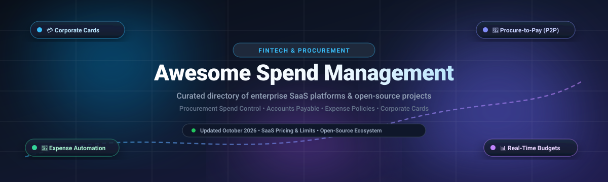

  

  
  
  
  
  
  
  

---

# 💳 Awesome Spend Management

> 🌟 **The Definitive Directory of Enterprise SaaS Solutions & Open-Source Projects for Business Spend Management (BSM), Procurement Spend Control, Accounts Payable Automation, Corporate Cards & Expense Governance.**

Welcome to **Awesome Spend Management**, an authoritative and curated knowledge base tracking modern **SaaS platforms** and **open-source repositories** designed for spend visibility, strategic sourcing, automated approval hierarchies, corporate card issuing, and financial ledger integration.

Whether you are a CFO evaluating procure-to-pay suites, a finance operations team automating expense claims, or an engineer deploying self-hosted procurement microservices, this guide equips you with verified market data, starting price points, free tier limits, and codebase telemetry.

---

## 📑 Table of Contents

- [🌐 Sector Overview & Market Dynamics](#-sector-overview--market-dynamics)
- [🏢 SaaS/Hosted Spend Management Platforms](#-saashosted-spend-management-platforms)
- [🔓 Open-Source GitHub Projects](#-open-source-github-projects)
- [📊 Open-Source Comparison & Architectural Notes](#-open-source-comparison--architectural-notes)
- [💡 Enterprise Evaluation & Selection Framework](#-enterprise-evaluation--selection-framework)
- [🤝 How to Contribute](#-how-to-contribute)
- [💖 Support & Sponsoring](#-support--sponsoring)
- [⭐ Star History](#-star-history)
- [⚖️ Disclaimer & Compliance](#️-disclaimer--compliance)
- [🏷️ Tags & Search Keywords](#️-tags--search-keywords)

---

## 🌐 Sector Overview & Market Dynamics

The global **Spend Management & Procurement Software** market is currently estimated at **$22 Billion – $28 Billion** and is projected to expand to **$55 Billion – $70+ Billion by 2034**, compounding at a **CAGR of 11.2% – 12.5%**.

From an industry structure perspective, the sector is **moderately fragmented** rather than a single winner-take-all monopoly:

- 🏛️ **Enterprise Direct Spend & S2P**: Legacy ERP and Business Spend Management (BSM) powerhouses like **SAP Ariba**, **Workday**, and **Coupa** dominate deep multi-million-dollar Fortune 500 contracts with comprehensive catalog management and complex supplier governance.
- 🚀 **Mid-Market & FinTech Disruptors**: High-growth fintechs like **Ramp**, **Brex**, and **Tipalti** command mid-market corporate cards, automated accounts payable (AP), and autonomous receipt matching by minimizing friction and offering generous entry tiers.
- 🔄 **Ongoing M&A Consolidation**: High fragmentation among specialized point solutions (e.g., tail spend analytics, contract intake, SaaS subscription tracking, and travel/expense) has triggered continuous private equity buyouts and platform roll-ups (such as Thoma Bravo acquiring Coupa for $8B, Cinven acquiring JAGGAER, and Paylocity acquiring Airbase for $325M).

---

## 🏢 SaaS/Hosted Spend Management Platforms

The table below catalogs premier hosted and cloud-native spend management solutions. Entries are **sorted descending by company size / market capitalization / enterprise valuation**.

| 🏢 Platform | 📈 Company Size / Valuation | 💵 Starting Pricing | 🎁 Free Tier & Trial Limits | 🎯 Key Spend Management Features |
| :--- | :--- | :--- | :--- | :--- |
| **[SAP Ariba](https://www.sap.com/)** | **Market Cap: ~$265 Billion+** *(Parent SAP SE; Annual Rev ~$35B+)* | **$80,000 / year** *(Billed annually on multi-year contract for core Sourcing / Buying modules; ~$6,666/mo equivalent)* | **No buyer free tier or trial**; suppliers receive a **Free Standard Account on SAP Business Network** *(unlimited PO receipts, standard digital invoices, and basic catalog uploads without subscription fees)* | Comprehensive Source-to-Pay (S2P) suite, automated purchasing workflows, Joule AI guided buying, contract lifecycle management, supplier risk analytics. |
| **[Workday Spend Management](https://www.workday.com/)** | **Market Cap: ~$68 Billion+** *(Annual Revenue ~$8.4B)* | **$45,000 / year** *(Mid-market financial bundles start at ~$99–$125/user/mo with mandatory annual enterprise contract)* | **30-day free trial** available exclusively for the *Workday Adaptive Planning* module *(full scenario modeling with sample data)*; core Spend platform requires custom sales-led sandbox proof-of-concept | Unified HCM & Financial Management integration, strategic sourcing, expense policies, purchase requisitions, automated approval chains, supplier lifecycle oversight. |
| **[Ramp](https://ramp.com/)** | **Valuation: $13.0 Billion** *(Series D; $300M+ ARR)* | **$0 / month** *(Ramp Free tier)*; paid **Ramp Plus** starts at **$15 / user / month** | **Free-forever plan with unlimited users & cards**; includes physical/virtual corporate cards, receipt matching via SMS/Slack, AP invoice OCR, ACH/check bill pay, and QuickBooks/Xero sync *(requires US entity & ~$25k bank balance)* | Autonomous corporate charge cards, AI duplicate subscription detection, automated vendor contract negotiations, multi-tier PO approvals, real-time receipt capture. |
| **[Brex](https://www.brex.com/)** | **Valuation: $12.3 Billion** *(Series D; $300M+ ARR)* | **$0 / user / month** *(Essentials tier)*; paid **Premium** tier starts at **$12 / user / month** | **Free-forever Essentials plan**; includes global card acceptance, up to **2 corporate entities** *(1 local + 1 global card program)*, automated receipt reconciliation, standard ERP sync, bill pay, and reimbursements | Global corporate cards, travel & expense management, AI audit compliance, multi-currency corporate bank accounts, real-time departmental budget tracking. |
| **[Tipalti](https://tipalti.com/)** | **Valuation: $8.3 Billion** *(Series F; $150M+ ARR)* | **$99 / month** base platform subscription fee for AP Automation *(+ variable transaction fees; Mass Payments starts at $249/mo)* | **No public free tier or self-serve trial**; offers a **14-day guided sandbox pilot** upon sales qualification with preloaded sample vendor datasets and simulated payment runs | AI accounts payable automation, self-service supplier onboarding portal, multi-currency payouts across 200+ countries, PO-to-invoice 2-way/3-way matching, W-8/W-9 tax compliance. |
| **[Coupa](https://www.coupa.com/)** | **Valuation: $8.0 Billion** *(Acquired by Thoma Bravo; $800M+ ARR)* | **$2,500 / month** *(~$21,800 – $30,000 / year minimum contract value for core procurement and invoicing modules)* | **No buyer free trial or free tier**; suppliers receive a **Free Basic Account on Coupa Supplier Network (CSN)** *(order acknowledgement, e-invoicing, and catalog hosting for unlimited connected buyers)* | Total Business Spend Management (BSM), community AI spend intelligence trained on $8T+ transactional spend, guided buying, contract compliance, supplier risk scoring. |
| **[GEP SMART](https://www.gep.com/)** | **Valuation: $2.5 Billion** *(Annual Revenue ~$350M+)* | **$75,000 / year** *(Single-module mid-market deployment; equates to ~$6,250/mo on multi-year contract)* | **No free tier or trial**; provides a **tailored 30-day proof-of-concept (PoC)** environment for pre-qualified enterprise procurement teams evaluating specific RFP/direct spend workflows | AI-native source-to-pay platform, unified intake management, direct & indirect spend control, contract compliance, supplier performance & ESG risk scoring. |
| **[JAGGAER](https://www.jaggaer.com/)** | **Valuation: $1.6 Billion** *(Acquired by Cinven / Vista; Revenue ~$250M+)* | **£4,600 / year** *(~$5,800/yr or ~$485/mo)* for Source-to-Contract Value Tracker *(up to 5 users)*; enterprise P2P starts at ~£142,900/yr | **No free tier or public trial**; enterprise buyers can request an **assisted sandbox demo** with sample product catalogs and simulated procurement approval workflows | Autonomous procurement orchestration, 1,000+ pre-built ERP connectors, 600+ REST APIs, supplier management, intelligent category management. |
| **[Ivalua](https://www.ivalua.com/)** | **Valuation: $1.2 Billion** *(Unicorn valuation; Revenue ~$200M+)* | **$150,000 / year** *(Entry-level enterprise deployment billed annually; equates to ~$12,500/month)* | **No free tier or trial**; offers an **enterprise guided pilot workshop** with custom procurement scenario simulation for qualified enterprise accounts | Unified Source-to-Pay (S2P) platform, configurable intake management, contract lifecycle management, direct & indirect procurement analytics. |
| **[Airbase](https://www.airbase.com/)** | **Acquired for $325 Million** *(Acquired by Paylocity; Parent Market Cap ~$10.5B)* | **$1,000 / month** *(Base platform fee billed annually for Growth tier; custom quote for Enterprise)* | **Free-forever Essentials plan** available for early-stage companies under 100 employees *(basic corporate cards, reimbursements, and receipt upload)*; no self-service trial for mid-market | Guided procurement intake, automated accounts payable (AP), corporate cards, 3-way PO matching, multi-subsidiary financial consolidation. |

---

## 🔓 Open-Source GitHub Projects

Below is an expanded, vetted list of open-source projects covering spend management, procurement, purchase orders, budgeting, and corporate expense tracking. 

Entries are **sorted descending by GitHub star count**. Each repository includes a social star badge linking directly to its **stargazers page**.

1. **[Odoo](https://github.com/odoo/odoo)**   
   *Python / JavaScript / PostgreSQL (LGPL-3.0)*  
   Modular open-source business suite with a dedicated **Purchase App** and **Expenses App**. Supports automated Request for Quotations (RFQs), purchase orders, vendor price lists, 3-way invoice matching, and departmental expense approvals.

2. **[ERPNext](https://github.com/frappe/erpnext)**   
   *Python / Frappe Framework / MariaDB (GPL-3.0)*  
   Comprehensive enterprise platform featuring an end-to-end **Buying & Procurement module**. Manages Material Requests, Supplier Quotations, Purchase Orders, Purchase Receipts, Landed Cost Vouchers, Supplier Scorecards, and real-time spend analytics dashboards.

3. **[Firefly III](https://github.com/firefly-iii/firefly-iii)**   
   *PHP / Laravel / Docker (AGPL-3.0)*  
   Self-hosted financial manager and expense controller. Features automated rule-based transaction pipelines, strict budget limits, recurring expense detection, and multi-currency spend category governance.

4. **[Invoice Ninja](https://github.com/invoiceninja/invoiceninja)**   
   *PHP / Laravel / Flutter (AAL/OSL-3.0)*  
   Invoicing, vendor billing, and expense management platform. Enables businesses to track vendor bills, log categorized business expenses, attach digital receipts, and route approvals prior to disbursement.

5. **[IDURAR ERP CRM](https://github.com/idurar/idurar-erp-crm)**   
   *Node.js / React / Express / MongoDB (MIT)*  
   Modern open-source business management system featuring purchase order creation, supplier expense tracking, payment milestone logging, and accounting ledgers.

6. **[Ever Gauzy](https://github.com/ever-co/ever-gauzy)**   
   *TypeScript / NestJS / Angular / PostgreSQL (Fair-Code / Apache-2.0)*  
   Open enterprise management ecosystem featuring corporate expense logging, purchase orders, vendor contract oversight, and multi-organization budget controls.

7. **[Crater](https://github.com/crater-invoice-inc/crater)**   
   *PHP / Laravel / Vue.js / Mobile Apps (GPL-3.0)*  
   Open-source invoice and corporate expense tracking suite designed for growing teams. Features receipt capture, tax calculation, expense categorization, and detailed payment reporting.

8. **[Dolibarr](https://github.com/Dolibarr/dolibarr)**   
   *PHP / MariaDB / PostgreSQL (GPL-3.0)*  
   Modular open-source ERP/CRM with dedicated modules for Supplier Commercial Proposals, Vendor Orders, Purchase Requisitions, Stock Receipts, and Spend Auditing.

9. **[Expensify App](https://github.com/Expensify/App)**   
   *React Native / TypeScript / Web (MIT)*  
   Official open-source client codebase for New Expensify. Offers chat-first expense reporting, receipt scanning via SmartScan OCR, split expense calculations, and corporate card feed integration.

10. **[Open Collective](https://github.com/opencollective/opencollective)**   
    *TypeScript / React / Next.js / GraphQL (MIT)*  
    Transparent spend management, fiscal sponsorship, and collective expense platform. Features publicly accountable expense claims, automated invoice approval workflows, virtual debit card issuance, and payout rails.

11. **[Rever](https://github.com/makerever/rever)**   
    *Python / Django / React (MIT)*  
    AI-powered finance automation platform featuring a Vendor Master registry, purchase order issuance, bill management with 2-way PO-to-bill matching, approval workflows, and immutable audit logs.

12. **[dubbl](https://github.com/dubbl-org/dubbl)**   
    *TypeScript / API-First (AGPL-3.0)*  
    Self-hosted financial backbone providing accounts payable, purchase requisitions, landed cost tracking, expense claims with receipt OCR, and budget variance (Budget vs. Actual) analysis.

13. **[FinPilot](https://github.com/Abhinavhaldiya/FinPilot)**   
    *JavaScript / React / Node.js / PostgreSQL (MIT)*  
    Enterprise expense approval system featuring claim submission, OCR receipt data extraction, multi-currency conversion, amount-threshold approval hierarchies, and departmental budget caps.

14. **[Shillinq](https://github.com/ConductionNL/shillinq)**   
    *PHP / Nextcloud App Ecosystem (EUPL-1.2)*  
    Business administration and procurement application for Nextcloud. Covers purchase orders, approval chains, supplier qualification questionnaires, budget forecasting, and contract spend dashboards.

15. **[VendSync (BidFlow)](https://github.com/RavalMunjal/VendSync)**   
    *React / Node.js / MongoDB (MIT)*  
    Full-stack procurement and vendor ERP. Handles RFQ creation, quotation side-by-side comparison, approval routing, PO generation, and real-time vendor spend analytics.

16. **[procure-to-pay-system](https://github.com/manziosee/procure-to-pay-system)**   
    *Django REST API / React TypeScript (MIT)*  
    Procure-to-pay workflow engine demonstrating multi-level approval hierarchies (Staff → Level 1 Approver → Level 2 Approver → Finance), automatic PO generation, and OCR invoice validation.

---

## 📊 Open-Source Comparison & Architectural Notes

While open-source tools provide immense flexibility, the open-source spend management landscape remains **specialized and modular**:

- 🧩 **Comprehensive Procurement Foundations**: **ERPNext** and **Odoo** provide the most battle-tested open-source foundations for enterprise procurement, offering RFQ cycles, 3-way matching, purchase orders, and supplier scorecards.
- 🧾 **Expense Approvals & AP Matching**: **FinPilot** delivers targeted multi-level expense approvals with receipt OCR, while **Rever** tackles AI-driven PO-to-bill matching.
- 💳 **Corporate Cards & Real-Time Banking**: Pure self-hosted platforms rarely provide direct corporate charge card issuing out of the box due to PCI DSS compliance and banking sponsor requirements; however, **Open Collective** integrates virtual card distributions and transparent ledger payouts.

---

## 💡 Enterprise Evaluation & Selection Framework

When selecting a spend management solution, cross-evaluate across these four pillars:

1. 🔍 **Spend Visibility & Intake**: Can employees easily submit purchase requests and receipts via Slack, Microsoft Teams, or mobile OCR?
2. ⚙️ **Policy Enforcement & Approval Rules**: Does the system enforce dynamic approval tiers based on cost center, department, and spending limits?
3. 🔗 **ERP & Accounting Integration**: Does the solution offer bi-directional two-way sync with NetSuite, SAP, Workday, QuickBooks, or Xero?
4. 🛡️ **Regulatory Compliance**: Does the vendor ensure PCI DSS Level 1, SOC 1 / SOC 2 Type II, and SOX-compliant audit trails?

---

## 🤝 How to Contribute

Contributions are warmly welcomed! Help us keep this directory accurate and comprehensive:

1. 🍴 **Fork the repository** on GitHub.
2. 📝 **Add or update entries** in `README.md` following the tabular or bulleted format.
3. 🔍 **Ensure specific data**:
   - Provide exact starting pricing (avoid generic tags like "Custom" or "Usage-based").
   - Detail free tier or trial duration and limits.
   - For open-source repos, include the social star badge linking to the stargazers URL.
4. 🚀 **Submit a Pull Request** with a brief summary of the changes.

---

## 💖 Support & Sponsoring

Thank you so much for exploring **Awesome Spend Management**! If this curated directory saves you time or aids your procurement and engineering decisions, please consider supporting the project:

- ⭐ **Star this repository** on GitHub to improve its discovery for fellow developers and finance leaders.
- 🍴 **Fork and contribute** by adding new tools, updating pricing tiers, or sharing use cases.
- 📢 **Share with colleagues**, CFOs, procurement managers, and finance operations teams.
- ☕ **Support the maintainer**: Sponsor ongoing research and curation via the [GitHub Sponsor Dashboard](https://github.com/sponsors/ishandutta2007).

  

---

## ⭐ Star History

---

## ⚖️ Disclaimer & Compliance

- This repository is a **community-curated index** created for educational and informational purposes; inclusion does not constitute commercial endorsement.
- Spend management platforms handling corporate cards, bank transfers, and employee reimbursements must adhere to relevant financial security standards (including **PCI DSS**, **SOX**, and **GDPR**).
- Open-source licenses vary: review specific repo licenses (e.g., AGPL-3.0, LGPL-3.0, GPL-3.0, MIT, EUPL) prior to enterprise deployment.

---

## 🏷️ Tags & Search Keywords

`spend-management` • `procurement-software` • `business-spend-management` • `procure-to-pay` • `source-to-pay` • `accounts-payable-automation` • `corporate-cards` • `expense-management` • `expense-automation` • `fintech` • `purchase-orders` • `vendor-management` • `budget-control` • `open-source-erp` • `spend-analytics`
